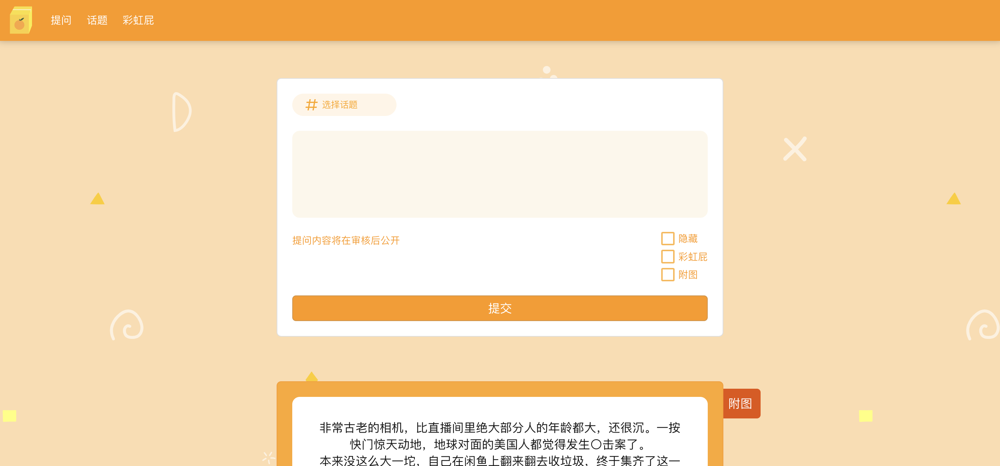

# JoiAsk 提问箱

可自行部署的开源提问箱，支持话题分类、图文投稿、内容审核与卡片归档，方便收集和展示观众提问。

**[使用文档](https://ask.powerlive.io/)** · **[在线示例](https://ask.vjoi.cn/)** · **[PowerLive](https://powerlive.io/)**

## 开始使用

推荐使用 Docker 部署，镜像为 `ghcr.io/xinrea/joiask:latest`。

按 **[快速开始](docs/guide/quick-start.md)** 完成配置、启动容器和创建管理员：

1. 准备 `config.json`，生成并填写独立的 `security.session_secret`。
2. 挂载配置、数据库和上传目录，启动容器。
3. 停止后端后，通过离线 CLI 创建超级管理员，再恢复服务。
4. 访问提问箱 `/` 和管理后台 `/admin`。

**新安装没有默认管理员或默认密码。** Session 密钥为必填项；已有部署应保留有效密钥。完整命令和安全注意事项统一维护在文档中。

## 文档导航

| 需要做什么 | 文档 |
| --- | --- |
| 首次部署 | [快速开始](docs/guide/quick-start.md) |
| 配置数据库、图片存储和安全选项 | [配置参考](docs/guide/configuration.md) |
| 管理账号、重置管理员密码 | [管理员与密码恢复](docs/guide/administrators.md) |
| 使用 Compose、配置 HTTPS 或更新镜像 | [部署与更新](docs/guide/deployment.md) |
| 使用格式标签、邮箱绑定和密码找回 | [投稿与邮箱](docs/guide/usage.md) |
| 自定义前台外观 | [自定义 CSS](docs/guide/custom-css.md) |
| 排查上传安全和运行问题 | [上传文件安全](docs/guide/upload-serving-security.md) / [故障排查](docs/guide/troubleshooting.md) |

## 参与开发

- [开发环境与贡献指南](CONTRIBUTING.md)
- [文档站开发与发布](docs/maintaining.md)
- [提交问题或建议](https://github.com/powerlive-io/JoiAsk/issues)

## 许可证

[MIT](LICENSE)
